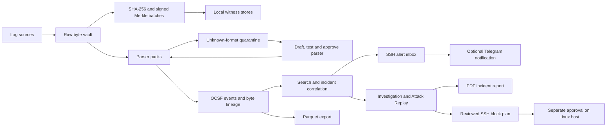

<div align="center">

# ANVAYA

### Follow the logs. Find the pattern. Verify the evidence.

**A self-hosted security log analysis and incident investigation platform for cybersecurity labs, students, and small deployments.**

Bring firewall, IDS, VPN, Windows, and Linux SSH logs into one OCSF event schema. Investigate linked activity, replay incidents, receive Telegram SSH alerts, and trace findings back to verifiable raw evidence.

[](backend/pyproject.toml)
[](frontend/package.json)
[](docker-compose.yml)
[](docs/ARCHITECTURE.md)

**[Try the hosted app](https://15.135.87.178.sslip.io/join) · [Watch the earlier demo](https://youtu.be/E_oxEl3_dA8) · [Quick start](#quick-start) · [Documentation](#documentation)**

**Exploring security monitoring, SOC workflows, or digital forensics? Start with the synthetic demo—no security appliance or cloud AI key needed.**

If this is a project you'd like to use or follow, **[give ANVAYA a star](https://github.com/parth171106/Anvaya)**. Found a useful workflow? Share the repository with your lab or cybersecurity club.

</div>

**Explore:** [Why ANVAYA?](#why-anvaya) · [Who is it for?](#who-is-it-for) · [Features](#features) · [Quick start](#quick-start) · [Real SSH workflow](#from-ssh-logs-to-a-reviewable-response) · [How it works](#how-it-works) · [Contribute](#help-improve-anvaya)

> **About the video:** The linked recording shows an older version of ANVAYA. It demonstrates the core workflow, but some newer features and interface changes are not shown. It is not a complete tour of the current hosted app.

## Why ANVAYA?

A firewall records a denied connection. A VPN records failed logins. An IDS flags a scan. Each source uses a different format, and an investigator needs both a common view and a way back to the original evidence.

ANVAYA connects those steps in one application:

- **Preserve the original:** save raw log bytes before parsing, including records from unrecognized formats.
- **Make logs comparable:** map supported formats into the Open Cybersecurity Schema Framework (OCSF).
- **Investigate related activity:** correlate events across devices and inspect a timeline with linked evidence.
- **Get notified:** receive an optional Telegram message when the SSH failure threshold is reached or a successful login follows it.
- **Check evidence integrity:** verify hashes, Merkle inclusion, signed batches, and local witness agreement.
- **Act with a review trail:** classify findings, save notes, export a PDF report, and prepare a temporary SSH block for separate approval on the affected server.

Built as a college cybersecurity project around **Smart India Hackathon problem statement SIH26156: Universal Log Pre-processing Framework**. It is intended for learning, demonstrations, and small deployments; it is not a production SIEM replacement or a certification of security compliance.

## Who is it for?

| You are… | Try ANVAYA to… |
| --- | --- |
| A cybersecurity student or instructor | Demonstrate the complete path from raw logs to investigation, integrity verification, and reviewed response. |
| A home-lab builder or Linux server owner | Collect SSH authentication activity and receive notifications about repeated failed connections. |
| Learning SOC analysis or digital forensics | Inspect evidence, replay an incident timeline, distinguish expected activity from suspicious behavior, and write up a finding. |
| Building a parser or log-processing tool | Work with OCSF mappings, unknown-format quarantine, byte lineage, and repeatable synthetic fixtures. |

You can explore the demo without real attacks, extra hardware, or a paid AI service. To monitor a real machine, configure its collector; an empty workspace does not generate findings by itself.

## Features

| Capability | What you can do |
| --- | --- |
| **Multi-source log ingestion** | Receive supported syslog/HTTP inputs and collect real Windows sign-ins or Linux SSH activity. |
| **OCSF normalization** | Search a common event schema while preserving source-specific attributes. |
| **Raw-to-event traceability** | Follow normalized fields back to original bytes using lineage and round-trip checks. |
| **Tamper-evident storage** | Check SHA-256 record hashes, Ed25519-signed Merkle batches, and two local witness stores. |
| **Incident correlation** | Review related reconnaissance, credential attacks, and access events across devices. |
| **Attack Replay** | Step through a stored incident's linked events to explain how the activity unfolded. Replay visualizes evidence; it does not execute an attack. |
| **SSH alert inbox** | Review repeated SSH failures and subsequent successful logins, classify findings, and optionally receive [private Telegram alerts](docs/SSH-ALERTS.md). No automatic blocking. |
| **Reviewed SSH response** | Prepare a [5- or 15-minute block plan](docs/SSH-RESPONSE.md) for new SSH connections from one public IP. A local server helper requires explicit approval and checks protected addresses. |
| **Investigation notes and PDF reports** | Save status, assessment, and notes; export an incident report with linked evidence and optional raw-record verification. |
| **Natural-language search** | Use supported query templates, an optional local model, or the optional Gemini assistant. |
| **AI-assisted investigation** | Ask follow-up questions and request evidence-referenced explanations with explicit consent. |
| **Unknown-format quarantine** | Preserve unrecognized logs, test parser drafts, and approve a parser before replaying records. |
| **Private workspaces** | Use separate user accounts, account-scoped logs, collector keys, and recovery codes. |
| **Dark mode and responsive layouts** | Review events and investigations on different screen sizes with light, dark, or system appearance. |
| **Data export** | Export normalized events to Parquet for analysis and data-lake workflows. |

### Supported sources

| Source | Current support |
| --- | --- |
| Cisco ASA | Parser pack for supported syslog message variants |
| FortiGate | Key-value log parser pack |
| Suricata | EVE JSON parser pack |
| Windows | Security sign-in events 4624 and 4625 through the Windows collector |
| Linux / OpenSSH | SSH journal logs; see the [Linux SSH guide](docs/LINUX-SSH.md) |
| Other formats | Raw storage and quarantine; normalization requires a matching parser |

ANVAYA does **not** automatically understand every device or log format. Unsupported records are retained for parser onboarding rather than silently presented as normalized events.

## See it in action

**[Open the hosted app](https://15.135.87.178.sslip.io/join)** to create an account and explore your own workspace. A new workspace starts without logs; it does not inherit the administrator's events. This is a college-hosted instance, so availability and signup capacity may vary.

For a reproducible example with events already defined, run the local synthetic demo below. No perimeter hardware or cloud AI key is required.

**[Watch the earlier demo video](https://youtu.be/E_oxEl3_dA8)** for an introduction to ingestion, normalization, correlation, and integrity checks. Its interface and feature set predate the current hosted deployment.

## Quick start

Prerequisites: **Git, Docker with Compose, Python 3, curl, and Bash**. On Windows, run these commands in WSL or a suitable Bash environment. Native PowerShell users can use the [live-log pilot guide](docs/LIVE_PILOT.md).

```bash
git clone https://github.com/parth171106/Anvaya.git
cd Anvaya
docker compose build
bash demo.sh --no-llm --speed 40
```

Open **[http://localhost:8080/overview](http://localhost:8080/overview)**. Press **1** while not typing into a field to start the synthetic scenario. The setup script prepares and resets the demo; it does not start the event sequence by itself.

> `demo.sh` resets the synthetic demo's stored data. Use the separate live-pilot or deployment configuration for logs you want to keep.

### A useful first walkthrough

1. **Overview / Live feed:** watch generated events arrive from different sources.
2. **Incidents / Attack Replay:** open the correlated incident, inspect its linked events, and replay the timeline.
3. **Event details:** compare normalized fields with raw evidence and lineage.
4. **Integrity:** run verification; then use the demo tamper control and verify again to see the changed evidence detected.
5. **Sources & parsers:** inject the unknown demo source and inspect quarantine and parser-test results.
6. **Investigation / PDF report:** label the finding as a controlled test, save a review note, and export a report.

Demo presenter shortcuts:

| Key | Action |
| --- | --- |
| Backtick | Open presenter controls |
| `1` | Start the synthetic scenario |
| `2` | Inject the unknown demo source |
| `3` | Silence or resume the demo firewall |
| `4` | Alter a selected demo record after it has been sealed |
| `5` | Simulate an insider re-signing the altered ledger |
| `6` | Change scenario speed |
| `0`, then `0` | Reset demo data |

These controls belong to **demo mode**. Synthetic traffic is generated locally; it does not attack external systems.

## From SSH logs to a reviewable response

Here is a practical workflow beyond displaying logs:

```text
Linux SSH journal
    → Collector uploads authentication events
    → ANVAYA detects repeated failed connections
    → Private alert inbox + optional Telegram notification
    → Analyst reviews evidence and nearby successful logins
    → Expected activity / Suspicious + investigation notes
    → Optional block plan → explicit approval on the affected server
```

The SSH rule flags **10 distinct failed connections from one IP to one device in a 10-minute correlation window**. A successful login after that threshold and within 15 minutes of the last failure can escalate the finding. Windows are anchored, not continuously sliding; this rule does not detect every attack.

**What has been exercised:** real EC2 SSH journal collection, an authorized failed-login test reaching the inbox and Telegram, and isolated firewall tests for blocking new connections, preserving an established connection, leaving another port reachable, expiry, and removal. The isolated expiry test uses a shortened timeout; these checks are not a general security audit or a production reliability guarantee.

**Response stays under your control.** Downloading a plan does not block an IP. The Linux helper requires local approval, checks the target hostname and protected/connected SSH addresses, and uses a kernel timeout. It blocks new SSH connections only; it does not evict an attacker already logged in. The console does not claim a downloaded plan was applied.

Historical imports and demo/controlled findings do not send automatic Telegram alerts. Do not turn your own management-IP test into a block target.

**Set it up:** [Linux SSH collection](docs/LINUX-SSH.md) → [Telegram alerts](docs/SSH-ALERTS.md) → [Reviewed SSH response](docs/SSH-RESPONSE.md).

## Use real logs or deploy it

- **Windows:** follow the [live-log pilot guide](docs/LIVE_PILOT.md). Run `pilot.ps1 Start` from the repository root, then use `pilot.ps1 Collect` with permission to read the Windows Security log.
- **Linux / EC2 SSH:** follow the [Linux SSH guide](docs/LINUX-SSH.md) for import and collection instructions.
- **Online deployment:** follow the [single-VM deployment guide](docs/DEPLOYMENT.md) for Docker Compose, HTTPS, private accounts, and authenticated collectors.
- **Password recovery:** see [recovery codes](docs/PASSWORD-RECOVERY.md). Save the recovery code when the application provides it.

The demo and live pilot use separate storage. A live dashboard needs incoming logs; starting the service alone does not create activity.

## How it works



**Backend:** Python, FastAPI, SQLite, DuckDB, PyArrow, declarative YAML parsers, and Ed25519 cryptography.

**Frontend:** React, TypeScript, Vite, and Tailwind CSS.

**Packaging:** Docker Compose with an optional Ollama service.

See the [architecture guide](docs/ARCHITECTURE.md) for implementation details and the [benchmark methodology and results](docs/BENCHMARKS.md) for measured performance, including the test environment and UDP-loss limitations.

## Optional AI

The core ingestion, parser packs, correlation, and cryptographic checks do not need a cloud AI provider. Template search also works without a model, using the supported question patterns.

**Local Ollama:** pull a model once while online, then use it locally:

```bash
docker compose --profile llm up -d ollama
docker compose exec ollama ollama pull qwen2.5:3b
```

**Gemini assistant:** optional and off by default. It adds natural-language search, follow-up filters, result and incident explanations, and investigation suggestions. See the [AI assistant setup and privacy guide](docs/AI-ASSISTANT.md).

Cloud-assisted search sends the question to the configured provider. Evidence explanations additionally require a preview and explicit consent to send selected log details. Generated SQL is constrained to read-only queries, and returned evidence references are validated. These checks do not guarantee that an AI explanation is correct.

Keep API keys in the documented Git-ignored secret files, not in source code or issues. Offline use requires dependencies and any local model to be downloaded beforehand; Gemini features require network access.

## What is real, and what is simulated?

| Component | Boundary |
| --- | --- |
| Raw storage, parsing, hashing, Merkle proofs, signatures, and round-trip tests | Executed by the application against stored data. |
| Local demo traffic | Deterministic synthetic logs, not evidence of a real intrusion. |
| Windows / Linux collectors | Read real permitted log sources; collection must be configured separately. |
| SSH alerts and Telegram | Rule-based detection and opt-in notification delivery, not proof that an intrusion occurred. |
| Temporary SSH response | Real nftables rules applied only through the local helper after approval; no autonomous blocking or remote-execution permission for collectors. |
| Attack Replay | A visualization of stored incident evidence, not a live attack simulator. |
| Demo parser drafting | May use a cached model draft or a hand-authored draft; validation, approval, and replay run against records. |
| Witnesses | Two local stores with separate keys, not independent external organizations. |
| SIEM delivery | A file sink, not a completed integration with an external SIEM. Parquet export is implemented. |
| Retention report | A template populated with actual counts, not compliance certification. |

An integrity check establishes specific consistency properties of the stored evidence. It does not prove a device told the truth, that an incident is malicious, or that the system is impossible to alter.

## Development and checks

For native development, use Python 3.11+ and a Node.js version supported by the frontend toolchain. Install backend dependencies from `backend/requirements.lock`, install `pytest`, `pytest-asyncio`, and `ruff` for development, and run `npm ci` in `frontend/`.

The Make targets below require Make and a compatible shell:

| Command | Purpose |
| --- | --- |
| `make dev-api` / `make dev-ui` | Run the API on port 8000 and Vite on port 5173 |
| `make test` | Run backend tests, frontend lint, and Vitest |
| `make e2e` | Run the synthetic demo and Playwright golden path; requires Playwright browser setup |
| `make offline-test` | Run the self-check in a container with networking disabled; build the API image first |
| `make bench` | Measure throughput and write the benchmark report |
| `make prebake` | Prepare the demo parser draft using the configured local model |

Useful test entry points: [raw vault](backend/tests/test_vault.py), [round-trip reconstruction](backend/tests/test_roundtrip.py), [ledger integrity](backend/tests/test_ledger.py), [correlation](backend/tests/test_correlation.py), [parser gates](backend/tests/test_parser_drafts.py), [SSH logs](backend/tests/test_linux_ssh.py), [account isolation](backend/tests/test_accounts.py), and [AI assistant](backend/tests/test_assistant.py).

## Documentation

| Guide | Start here for |
| --- | --- |
| [Architecture](docs/ARCHITECTURE.md) | Pipeline, storage, normalization, and integrity design |
| [Local live-log pilot](docs/LIVE_PILOT.md) | Real Windows sign-in collection |
| [Linux SSH](docs/LINUX-SSH.md) | SSH journal ingestion |
| [SSH alerts and Telegram](docs/SSH-ALERTS.md) | Detection rules, private bot setup, delivery behavior, and data sharing |
| [Temporary SSH response](docs/SSH-RESPONSE.md) | Plan preparation, protected IPs, local approval, expiry, and early removal |
| [Attack Replay](docs/ATTACK-REPLAY.md) | Exploring a stored incident's sequence and evidence |
| [Incident investigation](docs/INCIDENT-INVESTIGATION.md) | Status, notes, and review history |
| [Incident reports](docs/INCIDENT-REPORTS.md) | PDF exports and integrity-verification options |
| [Deployment](docs/DEPLOYMENT.md) | A persistent Linux VM with HTTPS and accounts |
| [AI assistant](docs/AI-ASSISTANT.md) | Model configuration, consent, and limitations |
| [Password recovery](docs/PASSWORD-RECOVERY.md) | Password visibility and recovery codes |
| [Benchmarks](docs/BENCHMARKS.md) | Measurements and their methodology |

Repository layout: `backend/` application and tests · `frontend/` console · `collectors/` real-log collection · `generator/` synthetic scenarios · `bench/` load testing · `docs/` guides.

## Help improve ANVAYA

- **Star the repository** if the project helps you learn or build something.
- **[Report a bug or suggest a feature](https://github.com/parth171106/Anvaya/issues)** with reproduction steps and the relevant version.
- **Contribute a parser or test fixture** for a source you know. Use synthetic or anonymized samples; remove credentials and private identifiers.
- **Improve documentation** when a setup step or explanation is unclear.

Good starting contributions include a sanitized parser fixture, a reproducible UI bug, a clearer setup example, or a regression test for a missed detection edge case. Explain the expected behavior and include enough information for someone else to reproduce it.

Discuss substantial changes in an issue before opening a pull request. Include relevant tests and explain what changed. Please do not post secrets or private log payloads in public issues.

Project contact: [anvaya-sih@proton.me](mailto:anvaya-sih@proton.me).

## Roadmap

Collector heartbeat and recovery notifications · independent witness services · external SIEM integrations · more parser packs (including Palo Alto, pfSense, and CEF/LEEF) · finer-grained roles · signed parser packs · larger-scale storage and ingestion · an offline installation bundle.

These are future directions, not claims about features already implemented.
